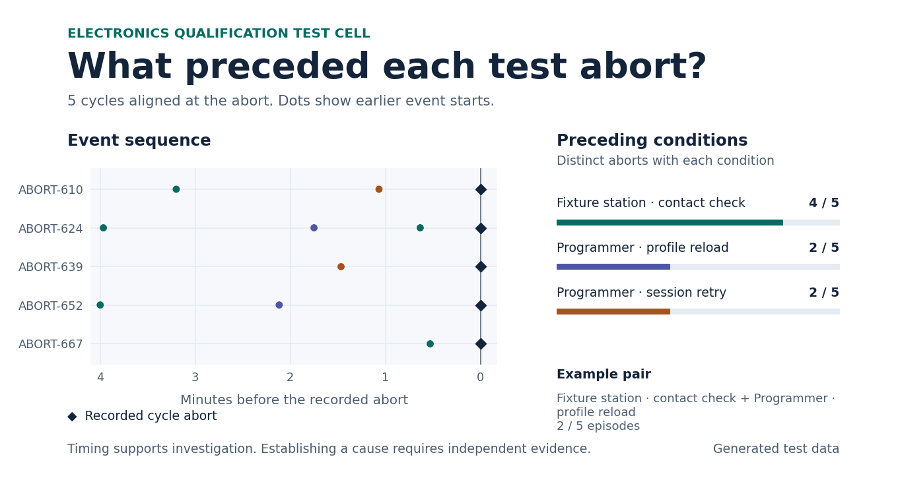

# Production Line Fault Analytics

[](https://github.com/stefan-mcf/production-line-fault-analytics/actions/workflows/checks.yml)

**A Python investigation tool for recurring equipment stops in overlapping event logs.**

Before deciding what to inspect, an engineer needs to know which log entries describe the same stop and which describe separate events. The analyser reconciles CSV exports by event ID, preserves source-row references, and compares the conditions recorded before each distinct stop.

In the generated test-cell logs, seven rows report an abort. Validation removes one invalid row and deduplication removes one repeat, leaving **five distinct aborts**. A separate comparison shows how accepting a disputed record would change which condition appears more often before those stops.

[Engineering case study](docs/case-study.md) · [Fixture results](#measured-fixture-results) · [Methodology](docs/methodology.md) · [Run the demo](#run-locally)

## Measured fixture results

| Check | Result |
| --- | --- |
| Input accounting | 23 rows reconcile to 16 distinct events, 3 repeated rows and 4 quarantined rows. |
| Abort count | 7 raw rows, 6 valid rows, 5 distinct episodes. |
| Most common preceding condition | A fixture contact check preceded 4 of the 5 aborts within four minutes. |
| Effect of admitting a disputed record | Profile reload preceded 2 of 5 aborts after quarantine. Admitting either disputed row independently raises that count to 3 of 5. |

[Investigation brief](report/example-report.md) · [Reconciliation comparison](report/reconciliation-check.json)



The practice review records insufficient evidence and proposes a reference run to compare the programmer session log with the bench abort record.

## Run locally

From the repository root, use Python 3.11+ and Make. The demo runs offline with the bundled CSVs and the Python standard library.

```sh
make demo
make check
```

The demo writes a Markdown brief, a JSON investigation report and the reconciliation comparison to `outputs/demo/`. The tests verify input counts, source rows, timing boundaries and exact reproduction of all three reports.

## Review in 2, 5 or 15 minutes

- **2 minutes** to scan the results and read the [example brief](report/example-report.md).
- **5 minutes** to trace the duplicate abort and the disputed reload in the [case study](docs/case-study.md).
- **15 minutes** to run the demo and inspect the [input and timing rules](docs/methodology.md), [analyser](analytics.py) and [comparison script](scripts/evaluate_reconciliation.py).
