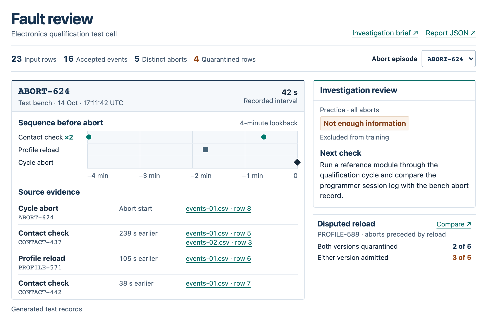
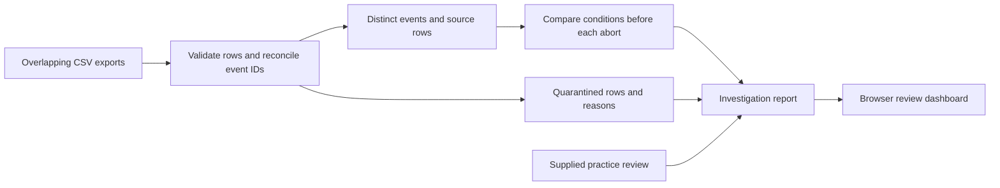

# Production Line Fault Analytics

[](https://github.com/stefan-mcf/production-line-fault-analytics/actions/workflows/checks.yml)

**A Python investigation tool for recurring equipment stops in overlapping event logs.**

When a qualification test aborts, an engineer needs to know how many distinct stops occurred, what was recorded before each stop, and which log entries support a follow-up check. Production Line Fault Analytics reconciles overlapping CSV exports, aligns earlier events with each abort and traces the findings back to source rows.

In two generated test-cell exports, **seven abort rows resolve to five distinct episodes**. A fixture contact check precedes four of those episodes. Admitting either version of a disputed programmer record would move profile reload ahead of session retry by frequency.

[Engineering case study](docs/case-study.md) · [Dashboard](#fault-review-dashboard) · [Labelling workflow](docs/case-study.md#review-labels-and-training-eligibility) · [Reconciliation results](#measured-reconciliation-results) · [Run locally](#run-locally)

## Fault review dashboard

The browser demo opens on an abort and shows the earlier events, their timing and the original CSV rows. Selecting another abort changes the evidence on screen. The investigation’s supplied practice assessment stays visible alongside its proposed next check.



*Two contact checks appear before ABORT-624. The earlier check links to both exports. Together the two checks contribute one episode to the condition count.*

The prototype’s finding review uses three assessments: **Needs checking**, **Expected / no further check**, and **Not enough information**. Relationship review has its own labels and eligibility rules. The public dashboard shows a read-only practice assessment of **Not enough information**, which is excluded from training. [Label definitions and eligibility](docs/case-study.md#review-labels-and-training-eligibility)

## The reconciliation problem

An export can repeat an event from an earlier batch. A repeated ID can also carry a different clear time. The first case would inflate the stop count if every row were counted. The second needs a record of the disagreement. The input contract requires an event ID, a station, a code and a UTC start time, with an optional clear time.

| Row disposition | Reconciliation rule |
| :--- | :--- |
| **Accept a distinct event** | Store one canonical event per valid event ID and retain its filename and line number. |
| **Merge an exact repeat** | Attach each matching source row to the same event. The repeat adds a source pointer and leaves the event count unchanged. |
| **Quarantine an invalid row** | Record the source and reason when a row fails field validation. A clear time before the start is one example. |
| **Quarantine a conflict** | Hold all valid versions of an ID when their fields disagree. Reading the exports in a different order gives the same result. |

## Scope and architecture

After reconciliation, the analyser selects test-bench aborts and matches starts at other stations during the preceding four minutes. A start exactly four minutes earlier qualifies. Simultaneous starts provide no ordering, so the analyser excludes them. Each station and code combination counts once per abort, even if it appears twice in its lookback. Pairs count only when both conditions precede the same abort.



| Workstream | What was built | Representative code | Checked-in evidence / docs |
| :--- | :--- | :--- | :--- |
| **CSV validation** | Enforces a five-column header, unique batch filenames, a station allowlist and explicit UTC timestamps. | [Parser and loader](analytics.py#L33-L75) | [CSV contract](docs/methodology.md#csv-input-contract) |
| **Event reconciliation** | Groups valid rows by ID, retains physical CSV line numbers and records rejected versions in quarantine. | [Grouping and origins](analytics.py#L76-L103) | [Structured report](report/example-report.json) |
| **Episode analysis** | Matches earlier starts, counts distinct episodes per condition and assembles a source-linked brief. | [Analysis and reporting](analytics.py#L110-L219) | [Investigation brief](report/example-report.md) |
| **Reconciliation comparison** | Checks how the abort count changes at each stage and reruns the analysis with each disputed row admitted separately. | [Comparison script](scripts/evaluate_reconciliation.py) | [Comparison results](report/reconciliation-check.json) |
| **Review dashboard** | Reads the report, lets the reviewer change episodes and shows each event with its original rows. | [Browser demo](demo/index.html) | [Dashboard preview](#fault-review-dashboard) |
| **Reproducibility** | Generates exports and review input, renders the chart from JSON, and checks that the reports reproduce byte for byte. | [Fixture generator](scripts/generate_fixture.py) · [Chart renderer](scripts/render_investigation.py) · [Tests](tests/test_analytics.py) | [CI workflow](.github/workflows/checks.yml) |

The reporting design keeps event counts, source origins and daily duration slices at separate grains. The ML evaluation plan sets out review targets, baselines and leakage controls. Both are designs for future work. [Reporting and ML plans](docs/methodology.md#proposed-reporting-and-ml-evaluation)

## Measured reconciliation results

The two exports contain 23 rows. Condition counts use the five reconciled test-bench aborts as their denominator. [Source exports](data/) · [Comparison results](report/reconciliation-check.json)

| Metric | Result | Denominator / scope |
| :--- | ---: | :--- |
| **Input accounting** | **23 rows** | 16 distinct events, 3 repeats retained as extra origins and 4 quarantined rows. |
| **Quarantined rows** | **4 / 23** | Two invalid rows and two conflicting versions of the same event. |
| **Abort count** | **7 → 6 → 5** | Validation rejects `ABORT-659`. Deduplication merges the two rows for `ABORT-610`. |
| **Fixture contact check** | **4 / 5** | Aborts with an earlier `CONTACT_CHECK`. |
| **Programmer profile reload** | **2 / 5** | Aborts with an earlier `PROFILE_RELOAD` after conflict quarantine. |
| **Programmer session retry** | **2 / 5** | Aborts with an earlier `SESSION_RETRY`. |
| **Most frequent pair** | **2 / 5** | Contact check and profile reload before the same abort. |


*Each row is aligned to the recorded abort. The shapes identify earlier event starts, and the legend counts distinct aborts for each condition.*

## The disputed reload record

Both exports record `PROFILE-588` starting at 09:40:29 UTC. One records a clear time of 09:41:04 and the other 09:40:53. The input carries no revision information that would establish which source should take precedence. Quarantining both records preserves the disagreement and makes the result independent of file order. [First export, row 12](data/events-01.csv#L12) · [Second export, row 11](data/events-02.csv#L11)

The comparison admits each version on its own. The shared start time is 99 seconds before `ABORT-667`, so either version adds that abort to the reload count. Reload moves from **2 of 5 to 3 of 5** and ahead of session retry, which remains at two. [Controlled comparison](report/reconciliation-check.json)

## Source rows and follow-up

`ABORT-610` has a 30-second recorded interval and appears in both exports. The report lists it once with both source rows. The same episode links to a contact check that began 192 seconds earlier and a session retry that began 64 seconds earlier. [First abort row](data/events-01.csv#L4) · [Repeated abort row](data/events-02.csv#L2) · [Episode trace](report/example-report.md#source-linked-episodes)

The frequency table describes which conditions appeared before recorded aborts. Estimating how often an abort follows a contact check would require comparable completed cycles, aligned clocks and sufficient log coverage. The supplied practice review records **insufficient evidence** and proposes running a reference module through qualification, then comparing the programmer session log with the bench abort record. [Practice review](data/practice-review.json) · [Engineering case study](docs/case-study.md)

## Run locally

From the repository root, use Python 3.11+ and Make. The analysis and tests run offline with the bundled CSVs and the Python standard library. Regenerating the chart separately requires Matplotlib.

```sh
make demo
make check
```

`make demo` writes the Markdown brief, JSON report and reconciliation comparison to `outputs/demo/`. `make check` verifies source row numbers, midnight crossings, missing clear times and the exact lookback boundaries. The suite also checks byte-for-byte report reproduction and runs the investigation with the export order reversed. [Verification tests](tests/test_analytics.py)

To browse the dashboard, serve the repository from its root and open the demo on localhost. The dashboard reads the checked-in reports, so this works immediately after cloning. [Dashboard source](demo/index.html)

```sh
python3 -m http.server 8000 --bind 127.0.0.1
```

[Open the local dashboard](http://127.0.0.1:8000/demo/)

## Review in 2, 5 or 15 minutes

- **2 minutes** to see the episode evidence and practice assessment. [Dashboard preview](#fault-review-dashboard) · [Investigation brief](report/example-report.md)
- **5 minutes** to trace a repeated event, inspect the disputed record and see which review decisions qualify as labels. [Case study](docs/case-study.md) · [Comparison results](report/reconciliation-check.json)
- **15 minutes** to run both Make targets and follow the implementation from parsing through episode analysis. [Methodology](docs/methodology.md) · [Analyser](analytics.py) · [Tests](tests/test_analytics.py)
