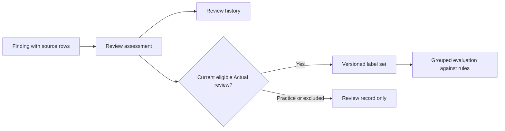

# Production Line Fault Analytics case study

Two generated test-cell exports repeat some events and disagree on when one event cleared. The analysis measures how those rows affect the abort count and the conditions an engineer would inspect. The [fixture generator](../scripts/generate_fixture.py) defines the records and the practice review.

## Abort counts and disputed records

The controlled comparison in [evaluate_reconciliation.py](../scripts/evaluate_reconciliation.py) and [reconciliation-check.json](../report/reconciliation-check.json) measures both effects on the 23 rows across [events-01.csv](../data/events-01.csv) and [events-02.csv](../data/events-02.csv). Raw counting finds 7 rows carrying the `CYCLE_ABORT` label. Row validation removes `ABORT-659` (`events-01.csv` row 13, where clear precedes start), leaving 6 valid abort rows. Exact-repeat deduplication merges the two identical copies of `ABORT-610`, leaving 5 distinct abort episodes.

Event `PROFILE-588` appears in both exports with the same start time (`2042-10-16T09:40:29Z`) and conflicting clear times, `2042-10-16T09:41:04Z` in [events-01.csv](../data/events-01.csv) row 12 and `2042-10-16T09:40:53Z` in [events-02.csv](../data/events-02.csv) row 11. Holding both rows in quarantine keeps `programmer` / `PROFILE_RELOAD` at 2 of 5 episodes. If either version of `PROFILE-588` were admitted on its own, `PROFILE_RELOAD` support would rise to 3 of 5 episodes, putting it ahead of session retry, which precedes two aborts. Both versions have the same start time, so either would add the same third abort to the profile-reload count.

## Trace an abort to its source rows

Event `ABORT-610` has a 30-second recorded interval. It appears in [events-01.csv](../data/events-01.csv) at row 4 and again in [events-02.csv](../data/events-02.csv) at row 2.

In [analytics.py](../analytics.py), the canonical event payload is stored once while both `(batch, row)` pointers are attached to its `origins` list. Within the preceding 240 seconds, two other-station events qualify as earlier conditions for `ABORT-610`.

- `CONTACT-431` (`fixture_station` / `CONTACT_CHECK`) starts 192 seconds earlier in `events-01.csv` row 2.
- `RETRY-817` (`programmer` / `SESSION_RETRY`) starts 64 seconds earlier in `events-01.csv` row 3.

The same origin-retention rule applies to the other exact repeats (`CONTACT-437` and `RETRY-826`). The checked-in [example report](../report/example-report.md) lists every episode and preceding event with its source batch and row number, and the [JSON evidence package](../report/example-report.json) records every quarantined row alongside its rejection reason.

## Events before each abort

Across the five reconciled `CYCLE_ABORT` episodes, `fixture_station` / `CONTACT_CHECK` precedes 4 of 5 aborts, while `programmer` / `PROFILE_RELOAD` and `programmer` / `SESSION_RETRY` each precede 2 of 5. Same-episode pairs show `CONTACT_CHECK` + `PROFILE_RELOAD` before 2 of 5 aborts (`ABORT-624`, `ABORT-652`) and `CONTACT_CHECK` + `SESSION_RETRY` before 1 of 5 (`ABORT-610`).

[Event timing chart](../assets/fault-investigation.png)

[Timestamp and counting rules](methodology.md)

## Review labels and training eligibility

The broader dashboard prototype records a review decision against the evidence the reviewer saw. A reviewer opens a finding, checks its episodes and source rows, then records an assessment and a next check. Reviewers choose an Actual or Practice session before making decisions. Corrections to grouping or equipment attribution follow a separate workflow.

### Finding review

| Assessment | What the reviewer records | Use in review-priority training |
| --- | --- | --- |
| **Needs checking** | The evidence warrants a follow-up. | Eligible positive from a current Actual assessment. |
| **Expected / no further check** | The condition is expected in the available context, and the reviewer has enough evidence to close the finding. | Eligible negative under the same rules. |
| **Not enough information** | More context is needed to decide. The reviewer can record a specific next check. | Retained as a review record and excluded from the binary label set. |

The eligibility check requires a current assessment with source provenance. Practice decisions, stale evidence, unresolved grouping or attribution issues and reviewer disagreements stay outside the label set. Skipping a finding leaves it unlabelled. When evidence changes, a new assessment can be made while the earlier decision remains in the review history.

### Relationship review

The prototype also lets a reviewer assess a proposed relationship between a finding and one or more preceding conditions. This is a separate judgement from deciding whether the finding needs checking.

| Assessment | What the reviewer records | Use in relationship training |
| --- | --- | --- |
| **Plausible relationship** | The available context supports investigating the relationship. | Eligible positive from a current, explicitly contributed Actual assessment. |
| **Appears unrelated** | The reviewer has enough context to assess the conditions as unrelated. | Eligible negative under the same rules. |
| **Expected sequence** | The conditions appear to follow normal operating order. | Retained separately and excluded from the binary label set. |
| **Not enough information** | Clock alignment, attribution or other context is insufficient to assess the relationship. | Retained as a review record and excluded from the binary label set. |

The prototype uses separate versioned label sets for review priority and relationship plausibility. For evaluation, related conditions and shared source evidence stay in the same partition. Unusual-episode ranking is a separate unsupervised task. The public example contains a bundled practice assessment and a read-only dashboard view of the report. [Dashboard preview](../README.md#fault-review-dashboard) · [Evaluation design](methodology.md#future-ml-evaluation-plan)

## Next check

The generated brief carries a supplied practice review from [practice-review.json](../data/practice-review.json) with an assessment of insufficient evidence. Its proposed next check is to run a reference module through the qualification cycle and compare the programmer session log with the bench abort record.

A preceding contact check can reflect a shared upstream step, routine fixture setup, or clock offset between devices. Estimating how often a check is followed by an abort would require comparable intervals with completed cycles and adequate log coverage.
