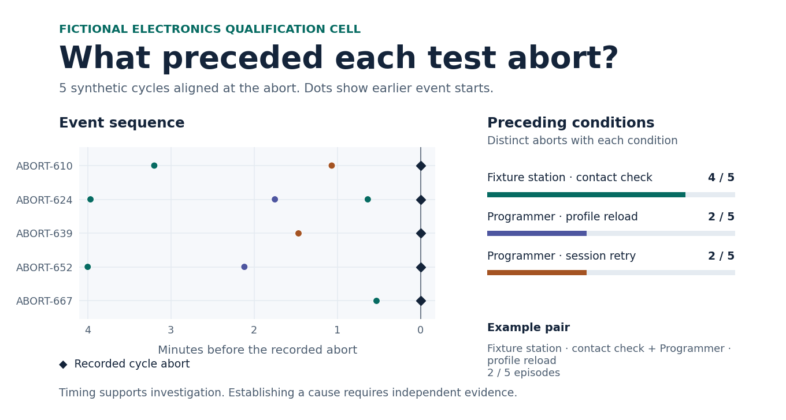

# Production Line Fault Analytics case study

Production Line Fault Analytics is a standalone Python project for investigating recurring equipment stops across overlapping log exports. It reconciles raw CSV batches into distinct events, preserves source row pointers, counts earlier conditions across separate stop episodes, and emits a deterministic JSON evidence package alongside a Markdown investigation brief.

## Problem and project scope

Recurring equipment stops often leave fragmented records across multiple exports. Repeated rows can inflate condition counts, conflicting updates can shift apparent durations, and raw event totals can hide whether a preceding condition appeared once per stop or repeated within a single episode.

This project addresses that workflow through an offline analyser tested on a fictional electronics qualification cell. Its station names (`test_bench`, `fixture_station`, and `programmer`), event codes, timestamps, and practice review note are generated by [generate_fixture.py](../scripts/generate_fixture.py).

| Area | Status | Scope boundary | Primary record |
| :--- | :--- | :--- | :--- |
| **CSV reconciliation and episode analysis** | Implemented | Offline Python analyser using the standard library | [analytics.py](../analytics.py) |
| **Checked-in synthetic evidence** | Implemented | Fictional qualification cell with 23 input rows and 5 aborts | [example-report.md](../report/example-report.md) · [example-report.json](../report/example-report.json) |
| **Investigation figure** | Implemented | Rendered directly from the generated JSON evidence | [render_investigation.py](../scripts/render_investigation.py) · [fault-investigation.png](../assets/fault-investigation.png) |
| **Automated verification** | Implemented | Unit tests covering row accounting, pointers, edge cases, and report parity | [test_analytics.py](../tests/test_analytics.py) |
| **Reporting tables** | Design plan | Proposed event, source-origin, and calendar-day tables | [Reporting design plan](#reporting-design-plan) |
| **ML evaluation** | Design plan | Proposed experiments, targets, and baseline comparisons | [ML evaluation plan](#ml-evaluation-plan) |

## Five qualification-cycle aborts

The fictional `test_bench` recorded five `CYCLE_ABORT` episodes across two overlapping exports, [events-01.csv](../data/events-01.csv) and [events-02.csv](../data/events-02.csv). The investigation identifies which other-station conditions started strictly before each abort within a four-minute (240-second) lookback window.

### Export reconciliation and quarantine

| Input accounting | Rows or events |
| :--- | ---: |
| Input rows | 23 |
| Distinct accepted events | 16 |
| Exact repeat rows retained as additional origins | 3 |
| Invalid rows quarantined | 2 |
| Conflicting rows quarantined | 2 |

Event `ABORT-610` appears in [events-01.csv](../data/events-01.csv) at row 4 and in [events-02.csv](../data/events-02.csv) at row 2. The analyser counts it once and retains both source references. Event `PROFILE-588` carries a different clear time in [events-01.csv](../data/events-01.csv) row 12 and [events-02.csv](../data/events-02.csv) row 11, so both rows enter quarantine. Holding every competing version prevents the reconciled output from depending on import order. The two invalid rows are quarantined for a clear time earlier than the start time (`events-01.csv` row 13) and an unknown station (`events-02.csv` row 12).

Event `ABORT-639` spans midnight (`2042-10-15T23:59:37Z` to `2042-10-16T00:02:14Z`) with a recorded duration of 157 seconds. Event `ABORT-652` has an unknown clear time (`null` duration) and remains in the episode list. Both contribute one episode to the support denominator.

### Earlier conditions, combinations, and time boundaries

| Earlier condition | Abort episodes preceded |
| :--- | ---: |
| `fixture_station` / `CONTACT_CHECK` | 4 / 5 |
| `programmer` / `PROFILE_RELOAD` | 2 / 5 |
| `programmer` / `SESSION_RETRY` | 2 / 5 |

| Same-episode condition pair | Abort episodes preceded |
| :--- | ---: |
| `fixture_station` / `CONTACT_CHECK` + `programmer` / `PROFILE_RELOAD` | 2 / 5 |
| `fixture_station` / `CONTACT_CHECK` + `programmer` / `SESSION_RETRY` | 1 / 5 |

Each condition contributes at most once per episode. Two `CONTACT_CHECK` events (`CONTACT-437` and `CONTACT-442`) occur before `ABORT-624` and together add one episode to the support count. `CONTACT_CHECK` and `PROFILE_RELOAD` precede the same abort twice (`ABORT-624` and `ABORT-652`), while `CONTACT_CHECK` and `SESSION_RETRY` precede the same abort once (`ABORT-610`). `PROFILE_RELOAD` and `SESSION_RETRY` appear in separate episodes.

Lookback comparisons require a candidate start strictly before the target start and at most 240 seconds earlier. Three events in the fixture exercise those boundaries.

- `CONTACT-463` starts exactly 240 seconds before `ABORT-652` and is included.
- `CONTACT-457` starts at the exact same second as `ABORT-639` (`2042-10-15T23:59:37Z`), supplies no ordering evidence, and is excluded.
- `RETRY-844` starts 241 seconds before `ABORT-667` and falls outside the four-minute window.

The checked-in [example report](../report/example-report.md) lists every included event with its source batch and row number. The [JSON evidence package](../report/example-report.json) also records every quarantined row and its rejection reason.

### Practice review and next check

The generated brief carries a supplied practice assessment of **insufficient evidence** from [practice-review.json](../data/practice-review.json). The proposed next check is to run a reference module through the qualification cycle and compare the programmer session log with the bench abort record.

Timing evidence narrows down what to inspect next. A preceding event can reflect a shared upstream dependency, routine setup activity, or clock offset between devices. Measuring how often a condition is followed by an abort would also require comparable operating intervals without an abort.

## Pipeline and design choices

The analyser in [analytics.py](../analytics.py) reads CSV batches, reconciles records in memory, evaluates episode-level lookbacks, and serialises deterministic JSON and Markdown outputs.

| Design choice | Implemented behaviour |
| :--- | :--- |
| **Input validation** | Require the expected CSV columns, a recognised station, a valid identifier and code, and explicit UTC timestamps at second precision. Reject any row whose clear time precedes its start time. |
| **Origin separation** | Store the canonical event payload separately from its list of source batch and row pointers. Append additional origins when an exact repeat arrives. |
| **Conflict quarantine** | Group valid rows by event identifier and compare payloads. Quarantine every competing version when any field differs. |
| **Unknown duration handling** | Accept a missing clear time, emit a `null` duration, and keep the event eligible for start-based lookback comparisons. |
| **Same-episode combinations** | Build the deduplicated set of preceding other-station conditions for each target episode. Count a pair only when both conditions occur within the same episode lookback. |

The JSON package records schema version, ingestion accounting, accepted events with origins, quarantined rows with reasons, episode-level preceding events with lead times in seconds, single-condition and pair support counts, and the supplied practice review.

## Verification

Running `make demo` regenerates the Markdown brief and JSON evidence package under `outputs/demo/`. Running `make check` executes [test_analytics.py](../tests/test_analytics.py), which verifies all input row accounting, reported source pointers, repeated and conflicting identifiers, midnight-spanning and unknown durations, strict lookback boundaries, and byte-for-byte reproduction of both checked-in reports in `report/`.

All input records are defined in [generate_fixture.py](../scripts/generate_fixture.py), and the chart is generated from the JSON evidence by [render_investigation.py](../scripts/render_investigation.py).

## Reporting design plan

A future reporting layer would separate event, source-origin, and calendar-day tables into distinct grains. Event counts belong to the distinct-event table, while source-origin rows support drill-through without multiplying counts. A daily duration measure can split known intervals across UTC midnight boundaries and verify that the daily slices sum to the original recorded seconds.

Recorded equipment intervals can overlap across stations. Estimating whole-cell downtime requires an explicit cell-state definition and sufficient telemetry coverage to establish unavailability. Versioned exports and stable event identifiers would allow a BI model to reconcile its measures against a fixed input snapshot.

## ML evaluation plan

The reconciled episode structure defines a baseline for three future experiments, each requiring its own target definition and acceptance criteria.

| Planned experiment | Target and baseline comparison |
| :--- | :--- |
| **Unusual-episode ranking** | Rank atypical event patterns and compare against simple ordering by duration or recurrence. Review whether top-ranked episodes surface checks an engineer considers useful. |
| **Investigation priority** | Learn which findings reviewers explicitly mark worth checking. Start with an interpretable classifier and compare against a count-based rule under the same review budget. |
| **Relationship plausibility** | Train on explicit reviewer assessments of whether a candidate relationship merits follow-up. Compare lead-time and support features against simple episode-support and majority baselines. |

Practice assessments, unresolved evidence, and unreviewed findings must stay outside any supervised target. Evaluation splits should group related conditions and shared source entries together. For later-period evaluation, features must use only records available at the intended review cutoff, reporting comparison population, review budget, missed examples, and variation across conditions. Forecasting future physical failures would require a separate prediction horizon and independently established outcomes.
